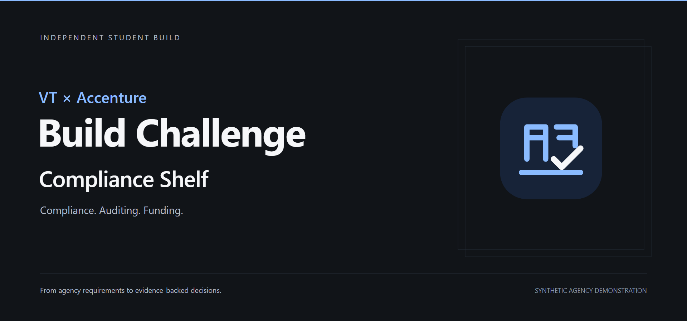

# Compliance Shelf

### VT × Accenture Build Challenge · Independent student project

A workspace for federal agency compliance reviews, records management, auditing, and funding decisions. Built with synthetic Department of Veterans Affairs (VA) and Social Security Administration (SSA) examples.

[Demo video](docs/media/compliance-shelf-demo.mp4) · [Walkthrough](docs/DEMO.md) · [API reference](apps/records-contracting/docs/API.md) · [Submission downloads](https://github.com/nsirivolu27/compliance-shelf/releases)

## Workflows

- **Evidence review:** connect documents and cited passages to checks, reviewer notes, and assessment history.
- **Records management:** track owners, retention schedules, and active holds.
- **Follow-up:** organize missing evidence, assigned tasks, and review deadlines.
- **VA / SSA intake:** manage form references and synthetic intake worksheets.
- **Funding:** simulate proposals, approvals, and reversals; enforce budget limits and keep agency balances separate.
- **Auditing:** trace saved decisions and export case packets with supporting evidence and activity history.

## Architecture

| Layer | Technology and role |
|---|---|
| Interface | HTML, CSS, and browser JavaScript modules |
| Backend | Node.js HTTP services with pure TypeScript decision rules |
| Services | Gateway, workflow, documents, jobs, policies, audit, guided assistant, and worker |
| Storage | JSON stores with revision checks, retry handling, and before/after history |
| OpenAI API | backend integration for evidence summaries and draft reviewer notes; human review before saving |
| AWS — optional | Deployment templates and backend packaging |

The current guided assistant uses deterministic tools. The planned OpenAI layer would explain retrieved evidence; existing rules would continue to calculate funding balances and enforce records holds.

## Repository

| Folder | Contents |
|---|---|
| `apps/records-contracting/` | Application, API, decision rules, tests, and documentation |
| `services/` | Local backend services and integration tests |
| `demo/` | Synthetic documents and walkthrough scenarios |
| `docs/` | Submission notes, verification, and final demo video |
| `infra/` | Container and AWS configuration |
| `app/`, `tests/` | Optional Python video-evidence module |

## Verification

Node.js 22.23.5 · 111 application tests + 26 service tests · TypeScript and build checks pass on Windows and Ubuntu.

[View automated checks](https://github.com/nsirivolu27/compliance-shelf/actions/workflows/verify.yml) · [Product details](apps/records-contracting/docs/PRODUCT.md)
