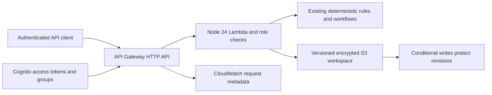

# AWS backend architecture

This is an undeployed, synthetic-data pilot package for Compliance Platform. It reuses the tested records-and-contracting API and pure screening rules. It does not deploy the frontend or the Python video pipeline. No AWS resources, users, or permissions have been created by preparing these files.



## What is implemented

- CloudFormation template: private versioned S3 bucket; Cognito user pool with administrator-created users; reader, reviewer, records-officer, and admin groups; JWT-protected HTTP API; Node.js 24 Lambda; restricted IAM permissions; and bounded CloudWatch log retention.
- Lambda adapter: accepts API Gateway payload v2, requires verified Cognito access claims, checks roles, loads a fresh workspace, and routes through the existing HTTP app on an ephemeral loopback socket. Only content type and the retry key are forwarded. Caller-supplied identity headers are ignored.
- S3 adapter: `If-None-Match: *` for first creation and `If-Match: <ETag>` for updates. A competing writer receives 409 and must reload. Access denial, malformed saved data, and service failures never silently initialize a replacement workspace. No unconditional writes or object deletion operations are supplied.
- Audit events use the verified Cognito subject. Retry keys are scoped to that subject, and mutation, audit event, and retry receipt are committed as one object write. Read-only requests do not create or update the object. Missing workspace data starts with the explicitly synthetic fixtures on the first successful mutation.
- `GET /api/session` identifies local versus AWS mode and returns the verified actor and roles. The existing frontend has not yet been wired to cloud sign-in or a remote API URL.

## Why this storage choice

The existing app stores a workspace as one atomic JSON snapshot. Conditional S3 writes preserve that contract without splitting the audit event and the case mutation across separate commits. Each Lambda request reloads the snapshot; only the SDK network client is reused. There is no warm-instance workspace cache and no Lambda `/tmp` database.

This is a small, single shared workspace, not a scalable multi-tenant database. All assigned users can read the whole workspace. The snapshot is limited to 4 MiB, including audit events and the most recent 1,000 retry receipts. Each write replaces the full object; concurrent edits can conflict even when they affect different cases. Move to per-case transactional DynamoDB records or a relational database before this workload grows. Do not put large documents, videos, or confidential agency records in this pilot.

S3 versioning helps recovery but does not make the audit immutable. The bucket has no Object Lock policy. No object-expiration lifecycle is configured, and storage versions incur ongoing cost after deployment. There is no claim of FedRAMP authorization, agency approval, production readiness, or legal compliance certification.

## Roles

| Group | Access |
|---|---|
| reader | All GET APIs and the read-only guided-agent POST |
| reviewer | Reader access plus case/context changes, evidence verification/corrections, analysis runs, finding reviews, and follow-up tasks |
| records-officer | Reader access plus record creation, schedule/ownership updates, and hold reviews |
| admin | All supported operations |

Users can belong to multiple groups. `admin` does not create a deletion operation. Hold release still requires its reference and rationale. Users with no recognized group receive 403. API Gateway validates signature, issuer, audience, expiration, and required scope; Lambda additionally requires `token_use=access`, the expected client/issuer, and the subject. The function must not be given public Function URL access or an additional unauthenticated invocation path.

Cognito has self-registration disabled, optional software-token MFA, 15-minute access tokens, and no client secret. No OAuth UI or login screen is bundled. An API client must complete Cognito authentication and send the access token as `Authorization: Bearer ...`. Do not send ID tokens as API credentials. The template permits SRP/password authentication and refresh; the default access scope used by these flows is required on the API route. Frontend auth remains a separate integration task.

## Build and validate locally

From the repository root:

```powershell
npm test
npx tsc --noEmit
npm run build
npm run build:aws
uv tool run --from cfn-lint cfn-lint -t infra/aws/template.json
```

`build:aws` creates a fresh directory under `infra/aws/dist/` and records its location in `infra/aws/dist/latest.json`. It strips TypeScript into `.mjs`, checks syntax, and copies only backend source plus the three public/synthetic fixture files and package metadata. No `.env`, runtime state, secrets, frontend assets, videos, or research documents are copied. The handler is `src/aws/handler.handler`.

The cloud adapter uses the AWS SDK v3 supplied by the Lambda Node.js runtime. No application dependency was added. This runtime SDK is not pinned; vendor a reviewed version for a production release. Local unit/integration tests inject an in-memory S3 transport, so they do not prove a live AWS deployment. The generated package can be imported locally without AWS credentials; actual AWS calls require its runtime SDK and an execution role.

## Deployment inputs still required

1. A chosen AWS account and region, credentials for that account, and a reviewed cost/access decision. There is no account or region hardcoded in the template.
2. A ZIP of the generated package contents, placed in an existing private versioned S3 artifact bucket in that region. Supply its bucket, key, and exact object version as `ArtifactBucket`, `ArtifactKey`, and `ArtifactVersion`.
3. `FrontendOrigin`: the exact permitted browser origin (defaults to `http://localhost:4317`). CORS does not authenticate a client. Add a frontend sign-in flow before attempting browser use of the cloud API.
4. Validate the template against AWS, inspect a CloudFormation change set including IAM changes, then execute it only when deployment is authorized. No deploy command runs automatically.
5. Create a synthetic-demo operator and assign the intended groups. Verify unauthorized requests fail, each role has the expected access, two concurrent edits cannot overwrite each other, and retries across Lambda instances return one committed event.

The stack retains the workspace bucket and user pool on deletion. Cleanup and data retention therefore require a deliberate separate decision. Request logs contain request ID, status, and route template, not request bodies or authorization headers. Lambda reserves concurrency of 5 and API Gateway throttles at 5 requests/second with burst 10; these are pilot limits, not a cost guarantee.

## Deferred components

The video service remains local and is disabled through this cloud adapter. A later design can put large files in a separate private S3 bucket and run video processing on an asynchronous container worker with a queue. Document extraction, Bedrock explanations, multi-workspace authorization, a production database, and immutable audit retention are not implemented here.

## References

- [AWS HTTP API JWT authorizers](https://docs.aws.amazon.com/apigateway/latest/developerguide/http-api-jwt-authorizer.html)
- [S3 conditional writes](https://docs.aws.amazon.com/AmazonS3/latest/userguide/conditional-writes.html)
- [Lambda Node.js packaging and runtime SDK](https://docs.aws.amazon.com/lambda/latest/dg/nodejs-package.html)
- [CloudFormation S3 bucket resource](https://docs.aws.amazon.com/AWSCloudFormation/latest/TemplateReference/aws-resource-s3-bucket.html)
